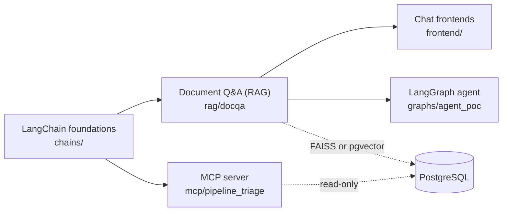

# agent-forge

Hands-on engineering across the LLM agent stack (**LangChain, RAG, LangGraph and the Model Context Protocol**), built in Python against Anthropic's Claude models. Each project is self-contained, runs locally, and is documented with the problem it solves and the trade-offs behind it.

## Featured: AI-assisted pipeline failure triage over MCP

**Problem:** every morning an on-call data engineer has to work out which ETL runs failed overnight and why. The data is in a run-audit table, but giving an AI assistant database credentials and free-form SQL is not acceptable.

**Solution:** a read-only MCP server that exposes exactly two purpose-built tools over PostgreSQL. The assistant decides *when* to call them. It can only do *what they allow*, and read-only access is enforced by the database itself.



→ **[Read the design write-up](mcp/pipeline_triage/README.md)**: problem framing, design decisions, verification (14 tests, MCP Inspector, live Claude Code session) and the path to production.

## Projects

| Project | What it does | Key engineering points |
|---|---|---|
| **[Pipeline Triage MCP server](mcp/pipeline_triage/)** | Lets an AI assistant triage failed ETL runs from a PostgreSQL audit table | Least-privilege tool surface; `READ ONLY` transactions; typed pydantic contracts that become the model-facing schemas; MCP-agnostic repository layer; protocol-level tests |
| **[Document Q&A (RAG)](rag/docqa/)** | Answers questions grounded in a PDF: load → chunk → embed → retrieve → Claude agent with a retriever tool | Vector store switchable between **FAISS** and **PostgreSQL/pgvector** through configuration, with no code changes; local sentence-transformer embeddings; UI-agnostic backend |
| **[Chat frontends](frontend/)** | Terminal chat and a Streamlit browser UI for the RAG agent | Depends only on the agent's public interface, so interfaces can change without touching ingestion or retrieval |
| **[LangGraph agent](graphs/agent_poc/)** | Rebuilds the document agent as an explicit `StateGraph` with multi-turn memory | Hand-wired tool loop (`ToolNode`, `tools_condition`), conditional routing and cycles, checkpointer-backed memory per `thread_id` |
| **[LangChain foundations](chains/)** | Focused scripts on the agent building blocks | `create_agent`, structured output, streaming, message history and memory, multimodal input, dynamic prompts and models, custom hooks (`before_model`, `wrap_model_call`) and built-in middleware such as summarization |



## Engineering principles applied

- **Separation of concerns.** Retrieval logic knows nothing about the UI, and the MCP repository knows nothing about MCP. Each layer can be replaced independently.
- **Configuration over code changes.** Infrastructure choices such as the vector backend and database DSN come from the environment, and no credentials live in the repository.
- **Least privilege for AI access.** Models get narrow, typed tools rather than raw database access. Guardrails are enforced by the system (PostgreSQL), not by the prompt.
- **Verification proportional to risk.** The MCP server, which touches a database on an AI's behalf, has tests at the repository, protocol and process level, plus a live AI-host run.

## How I work with AI

I use Claude Code as an implementation partner. I own the problem framing, scope and constraints (for example: read-only access, no arbitrary SQL, isolated subprojects), review the output critically, and require evidence (tests, protocol inspection, live runs) before anything is merged.

## Getting started

Requires Python 3.11+ and [uv](https://docs.astral.sh/uv/). The LangChain, RAG and LangGraph projects need an `ANTHROPIC_API_KEY` in `.env`. The MCP server needs only a local PostgreSQL.

```bash
uv sync

# Document Q&A: build the index once, then chat
uv run python -m rag.docqa.vectorstore
uv run python -m frontend                 # terminal
uv run streamlit run frontend/ui.py       # browser

# LangGraph agent with multi-turn memory
uv run python -m graphs.agent_poc

# MCP server: separate subproject with its own environment
cd mcp/pipeline_triage && uv sync && uv run pipeline-triage-seed-demo && uv run pytest
```

Each project's README has the full walkthrough.

## Repository layout

```
agent-forge/
├── chains/              LangChain building blocks, one concept per script
├── rag/docqa/           RAG pipeline: loader, splitter, vector store, retriever tool, agent
├── frontend/            Terminal and Streamlit interfaces for the RAG agent
├── graphs/agent_poc/    LangGraph agent: state, routing, tool loop, memory
└── mcp/pipeline_triage/ Read-only MCP server over PostgreSQL (standalone subproject)
```
