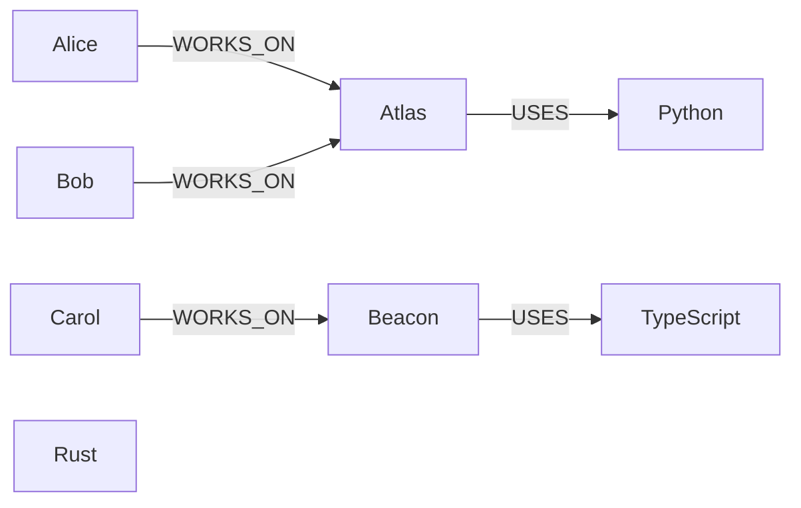
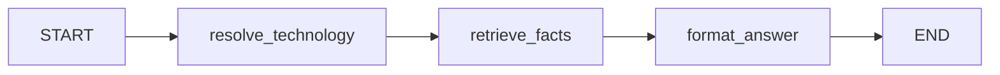

# Your first knowledge graph

This small, fictional example runs locally using the repo's existing LangGraph
and Streamlit dependencies. No API key, LLM, database server, or new dependency
is needed. Run commands from the repository root.

## Start here

```bash
uv sync
uv run python -m graphs.knowledge_poc
```

Expected answer: **Alice, Bob work on projects that use Python.** The command
also prints the stored facts, workflow steps, and evidence for the answer.

For the interactive browser playground:

```bash
uv run python -m streamlit run graphs/knowledge_poc/ui.py
```

If the repository's environment is already installed, you can use
`.venv/bin/python` in place of `uv run python` without syncing dependencies.

## What is a knowledge graph?

It represents knowledge as things and the relationships between them:

| Term | Meaning | Example |
| --- | --- | --- |
| Entity / node | A thing with an identity | Alice, Atlas, Python |
| Type / label | The kind of thing | Person, Project, Technology |
| Property | Information about a thing | Alice's `name` |
| Relationship / edge | A named, directed connection | Alice **WORKS_ON** Atlas |
| Triple | One subject–relationship–object fact | (Atlas, USES, Python) |
| Hop | Following one relationship | Atlas → Python |



To answer **“Who works on projects that use Python?”**, find projects with a
`USES` edge to Python, then people with a `WORKS_ON` edge to those projects.
The path from a person to Python contains two edges, so this is a **two-hop query**.
Alice and Bob match; Carol does not. Each returned path explains the answer.

This does **not** establish that Alice knows Python. Working on a project and
knowing a technology are different facts. Likewise, no matching facts means
we lack evidence in this dataset, not that something is impossible in real life.

## Does it work with LangGraph?

Yes. They serve different purposes, even though both use the word “graph.”

| | Knowledge graph | LangGraph workflow |
| --- | --- | --- |
| Nodes represent | Entities such as Alice | Functions such as `retrieve_facts` |
| Edges represent | Facts such as WORKS_ON | Which step executes next |
| Purpose | Store and connect knowledge | Coordinate work and pass state |
| Code here | `knowledge.py` | `workflow.py` |



The workflow resolves a technology name, queries the knowledge graph, and
formats an answer from the returned facts. Its state carries the input,
resolved ID, matching people, evidence, and answer between steps.
LangGraph does not automatically create or store the knowledge graph.

An LLM could later turn a natural-language question into a structured query or
explain the retrieved facts. Here the question template is fixed, and the user
supplies the technology. This lets you inspect the mechanics without model calls.

## Try these experiments

1. Run `uv run python -m graphs.knowledge_poc --technology TypeScript`.
   Only Carol should match.
2. Try `--technology Rust`. Rust exists, but has no project connections.
3. Try `--technology Java`. Java is not an entity in this dataset.
4. In `knowledge.py`, add `Fact("beacon", "USES", "python")` to `FACTS`.
   Run the Python query again: Carol now matches too. The initial-dataset test
   will need updating if you keep this change.
5. Add a new Person entity and a WORKS_ON fact, then inspect the browser diagram.

Read `knowledge.py`, then `workflow.py`, then `__main__.py` in that order.

## Scope and next steps

Facts are manually curated Python objects in memory, reloaded on each run.
The query scans a tiny dataset; it is not a production graph database or a
general natural-language question answering system. A knowledge graph can
exist without a graph database; a database adds persistent storage and querying
for larger datasets.

Unlike vector retrieval, which searches for similar text, this example follows
explicit relationships. A later GraphRAG experiment could retrieve connected
facts and provide them as context to an LLM. Importing facts from documents
would also require extraction, resolving duplicate entities, source tracking,
and validation. Those are separate steps beyond this first demo.

## Verify

```bash
uv run python -m unittest graphs.knowledge_poc.test_poc -v
```

Official background: [graph data concepts](https://neo4j.com/docs/getting-started/appendix/graphdb-concepts/)
and [LangGraph StateGraph](https://reference.langchain.com/python/langgraph/graph/state/StateGraph).
