# MCP POC: Data Pipeline Triage (PostgreSQL)

A small, read-only MCP server that lets an AI assistant answer:

> "Which pipelines failed on November 15, 2026, and why?"

Python + the official MCP Python SDK (v2) + PostgreSQL. No LLM API key is needed to run or test the server.

## The idea in two pictures

How MCP works in general (host, client, server, and who does what):



What happens in this POC: two tool calls and one answer, using the real messages:



## Files

| File | Role | Knows about MCP? |
|---|---|---|
| `db.py` | Connection settings from the environment, read-only session | no |
| `audit_store.py` | Two parameterized SQL queries | no |
| `init_demo_db.py` | Creates DB `pipeline_triage_demo` and seeds 5 fake runs | no |
| `server.py` | Publishes the two queries as MCP tools | **yes, only this file** |
| `tests/` | DB tests + a real MCP client talking to `server.py` over stdio | |

The MCP layer is a thin wrapper of about 50 lines. Everything else is ordinary data-engineering code.

## Run it

Prerequisites: a local PostgreSQL you can reach with `psql`, plus `uv`. Node is only needed for Inspector.

```bash
cd mcp/pipeline_triage
uv sync
uv run python init_demo_db.py          # creates pipeline_triage_demo (touches nothing else)
uv run pytest -q                       # 10 tests: SQL layer + real MCP client/server
```

**Configuration.** `PIPELINE_TRIAGE_DSN` (optional, default `dbname=pipeline_triage_demo`). Host, user and password come from the standard `PGHOST`, `PGUSER` and `PGPASSWORD` variables or from libpq defaults; see `.env.example`. No credentials are in the code. The seeder refuses to run against any database whose name doesn't end in `_demo`.

### 1. Test with MCP Inspector (no AI involved)

```bash
uv run mcp dev server.py               # opens the Inspector UI in the browser
```

In the **Tools** tab, click *List Tools*, then run `list_failed_runs` with `2026-11-15`. You should get runs 101 and 102. Then run `get_run_details` with `101`.

Scriptable version:

```bash
npx -y @modelcontextprotocol/inspector@2.13.0 --cli "$PWD/.venv/bin/python" server.py --method tools/list
npx -y @modelcontextprotocol/inspector@2.13.0 --cli "$PWD/.venv/bin/python" server.py \
    --method tools/call --tool-name list_failed_runs --tool-arg business_date=2026-11-15
```

### 2. Use it from Claude Code (the AI host)

```bash
claude mcp add --scope local pipeline-triage -- \
    uv run --directory "$PWD" python server.py
claude mcp list                        # pipeline-triage: ✔ Connected
```

Then ask Claude Code: *"Which pipelines failed on November 15, 2026, and why?"* It calls `list_failed_runs`, then `get_run_details` for each run, and explains the errors. To remove it: `claude mcp remove pipeline-triage -s local`.

## Concepts

**What problem MCP solves here.** On-call engineers dig through audit tables by hand. We want an assistant to do that, but safely: it should get *specific, read-only operations*, not a database password. MCP is the standard plug that turns those operations into tools any AI host can discover and call.

**Why MCP instead of letting the AI run SQL directly?**
- *Safety:* the AI can only call `list_failed_runs` and `get_run_details`. There is no arbitrary SQL. Values are bound as parameters, and the session is `READ ONLY`, so Postgres itself rejects writes.
- *Credentials stay put:* the DSN lives in the server's environment. The LLM never sees it.
- *Reuse:* the same server works in Claude Code, Claude Desktop, IDEs and Inspector, without per-host glue code.
- *Domain knowledge in one place:* "failed" means `status = 'FAILED'`, written once in the server, not re-guessed by the model each time.

**Host vs client vs server.**
- **Host:** the app with the LLM (here, Claude Code). It owns the conversation and permissions, and the LLM inside it **decides** which tool to call.
- **Client:** a connector inside the host, one per server. It launches `server.py` and speaks JSON-RPC to it over stdin/stdout.
- **Server:** `server.py`. It advertises tools and **executes** them. There is no LLM inside it.

**Tool discovery and invocation.**
1. *Discovery* (`tools/list`, at connect time): the server returns each tool's name, description and JSON Schema. The SDK builds these from the Python function name, docstring and type hints, so `run_id: int` becomes `{"type": "integer"}`. The docstring is effectively a prompt: it tells the model when to use the tool.
2. *Invocation* (`tools/call`): the client sends `{"name": "list_failed_runs", "arguments": {"business_date": "2026-11-15"}}`, and the server runs the function and returns the result.

**MCP vs a REST API.** REST is built for programs whose developer already knows which endpoint to call. MCP is built for an AI that discovers capabilities at runtime: tools describe themselves in model-readable form, sessions are stateful, and the transport can be local stdio (no port and no web server). They also stack: an MCP server often just wraps a REST API.

**How the PostgreSQL rows reach Claude.** `psycopg` returns rows, and `audit_store` converts dates to ISO strings. The tool returns a `list`, or a `TypedDict` that also gives it an output schema. The SDK serializes that into a JSON-RPC result with `structuredContent` and sends it over stdout. The client puts it in Claude's context as a tool result, and Claude reads it and writes the answer, or calls another tool first.

**Errors (SDK v2 detail).** A raised `ToolError` sends its message to the model, which lets it fix bad input itself. Any other exception counts as a crash: the client only sees "Error executing tool", and the details stay on the server.

## Interview questions

1. **Does the MCP server call the LLM?** No. The server only exposes tools. The LLM runs in the host and decides when to call them, and the server just executes calls and returns data.
2. **How do you stop an AI from running destructive SQL through MCP?** Don't offer a generic `run_sql` tool. Expose narrow tools, bind parameters, use a read-only transaction or a role with only `SELECT` privileges, and keep credentials inside the server's environment.
3. **How does the model know what a tool does and which arguments it takes?** Through discovery: `tools/list` returns the name, description and JSON input schema, which the host passes to the model. Good descriptions directly improve tool selection.
4. **stdio vs Streamable HTTP transport?** stdio: the host launches the server as a local subprocess, which is simple, needs no network, and gives one user per process. HTTP: a remote, shared server that needs authentication and scales. Use HTTP for a team-wide service.
5. **MCP vs REST: when would you skip MCP?** When a regular program already knows exactly which endpoint to call, REST or a direct library call is simpler. MCP pays off when an AI has to discover and choose operations itself, and when you want one integration to work across many AI hosts.

## Out of scope for this first POC

No write tools, auth, HTTP transport, resources or prompts. Natural next steps: a `SELECT`-only database role, then Streamable HTTP with auth for team use.
